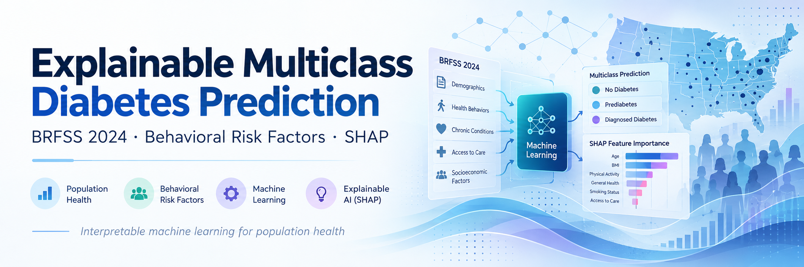

<p align="center">
  
</p>

<h1 align="center">Explainable Multiclass Diabetes Prediction with BRFSS 2024</h1>

<p align="center">
  <strong>Behavioral/Health-Status Factors · Multiclass Machine Learning · SHAP Explainability</strong>
</p>

<p align="center">
  <a href="#overview">Overview</a> ·
  <a href="#study-at-a-glance">Study</a> ·
  <a href="#selected-findings">Findings</a> ·
  <a href="#repository-structure">Code</a> ·
  <a href="#data-access">Data</a> ·
  <a href="#citation">Citation</a>
</p>

---

## Overview

**Research code accompanying an accepted peer-reviewed manuscript:**

> **Quantifying Behavioral Contributions to Diabetes Risk Using an Explainable Multiclass Machine Learning Framework with BRFSS 2024**  
> Sumit Barua, Sohaib Jabran, Charles Rodgers, and Alvis Fong  
> *Discover Public Health* · Accepted 13 October 2026 · Publication DOI pending

This repository documents an explainable multiclass machine-learning study using the **2024 Behavioral Risk Factor Surveillance System (BRFSS)**. The analysis distinguishes self-reported **no diabetes, prediabetes, and diabetes**, compares a behavioral/health-status feature set with an expanded feature set, and quantifies model-attributed contributions from behavioral/health-status, demographic, and anthropometric domains.

> **Reproducibility status:** The eight numbered scripts were organized from the research workflow and syntax-checked, but **have not been validated together through an end-to-end run**. Numerical values below are **findings reported in the accepted manuscript**, not independently regenerated repository outputs. These scripts should not yet be treated as a verified reproduction package.

## Study at a glance

| Component | Study design |
| --- | --- |
| Data source | CDC BRFSS 2024 public-use survey |
| Analytic sample | **453,241** respondents |
| Outcome | Self-reported `DIABETE4`: no diabetes (0), prediabetes (1), diabetes (2) |
| Data partition | Stratified 80/20 train/test split: **362,592 / 90,649**; random seed 42 |
| Model-1 | 14 behavioral/health-status original predictors |
| Model-2 | 23 original predictors across three domains; **122 encoded features** in the final analysis |
| Classifiers | Logistic Regression, Decision Tree, Random Forest, XGBoost |
| Evaluation | Macro-F1, balanced accuracy, weighted F1, macro ROC-AUC, class-specific metrics, bootstrap CIs, calibration, LLCPWT sensitivity, subgroup analysis |
| Explainability | Diabetes-class global SHAP, domain attribution, top-*k* overlap, exploratory geographic SHAP |

## Selected findings

| Finding | Reported result |
| --- | --- |
| Best class-balanced performance | Logistic Regression Model-2: **macro-F1 0.426**, **balanced accuracy 0.512** |
| Highest prediabetes recall | Decision Tree Model-2: **recall 0.338**, **precision 0.040** |
| Highest weighted F1 / macro ROC-AUC | XGBoost Model-2: **0.775 / 0.765**, but **prediabetes recall 0.000** |
| Behavioral/health-status attribution | **42.71%** |
| Demographic attribution | **45.21%** |
| Anthropometric attribution | **12.08%** |

The three percentages reflect **relative shares of diabetes-class mean absolute SHAP attribution in XGBoost Model-2**. They are not causal effects, population-level risk fractions, or evidence that all behavioral/health-status factors are modifiable. Self-rated health and unhealthy-days measures may reflect existing disease burden.

## Repository structure

```text
BRFSS-2024-Explainable-Diabetes-ML/
├── assets/
│   └── research-banner.png
├── src/
│   ├── 01_preprocessing.py
│   ├── 02_train_models.py
│   ├── 03_evaluate_models.py
│   ├── 04_bootstrap_analysis.py
│   ├── 05_calibration.py
│   ├── 06_survey_weight_analysis.py
│   ├── 07_subgroup_analysis.py
│   └── 08_shap_analysis.py
├── data/
│   ├── README.md
│   ├── raw/                # not distributed
│   └── processed/          # not distributed
├── models/                 # generated models; not distributed
├── results/
│   ├── tables/            # selected summary CSVs have be added
│   └── figures/
├── README.md
├── CITATION.cff
├── requirements.txt
└── .gitignore
```

The filenames are numbered to show the intended workflow. Scripts **01 and 02 are prerequisites**; scripts **03–08** analyze saved outputs from those steps and do not generally depend on one another.

## Data access

The source data are publicly available from the **U.S. Centers for Disease Control and Prevention (CDC)**:

- [BRFSS homepage](https://www.cdc.gov/brfss/)
- [BRFSS 2024 annual data and documentation](https://www.cdc.gov/brfss/annual_data/annual_2024.html)
- [Dataset preparation and provenance notes](data/README.md)

The original approximately 1 GB SAS transport file (`CDC_BRFSS2024.XPT`) is **not redistributed**. Nor is the processed respondent-level dataset included at present. The code expects the source file under `data/raw/` by default. The original public-use file and official CDC variable coding guidance should be used to reconstruct the analytic sample.

If a verified processed dataset is shared separately in the future, its provenance, processing version, checksum, and applicable redistribution conditions will be documented in `data/README.md`.

**Survey-design caveat:** The primary models are not full design-aware BRFSS estimators. `LLCPWT` was used only for an evaluation-stage sensitivity analysis; the workflow does not jointly account for sampling weights, strata, clustering, and design-based variance estimation. The exploratory geographic SHAP outputs are **not estimates of diabetes prevalence or comparative geographic risk**.

## Computational workflow

Install the listed dependencies in an appropriate Python 3.12 environment:

```bash
python -m pip install -r requirements.txt
```

Place the original CDC `.XPT` file in `data/raw/`, then run the scripts **from the repository root** in the numbered order:

```bash
python src/01_preprocessing.py --raw data/raw/CDC_BRFSS2024.XPT
python src/02_train_models.py
python src/03_evaluate_models.py
python src/04_bootstrap_analysis.py
python src/05_calibration.py
python src/06_survey_weight_analysis.py
python src/07_subgroup_analysis.py
python src/08_shap_analysis.py
```

**Important:** These are intended commands, **not end-to-end tested reproduction instructions**. The first script is designed to save transformed training/test data under `data/processed/`; training saves models under `models/`; the analysis scripts write tabular outputs under `results/tables/`. Do not assume a new run will exactly match the paper until the pipeline is independently checked.

### Computational environment

The final research environment used **Python 3.12**, `numpy==2.1.3`, `pandas==2.2.3`, `scikit-learn==1.6.1`, `xgboost==3.1.1`, and `shap==0.50.0`. See [`requirements.txt`](requirements.txt) for declared dependencies; exact versions of some supporting packages were not recorded.

## Citation

**If you use the research methods, analysis, or results, please cite the associated journal article.** The following is provisional until Springer Nature publishes the final DOI and article details:

> Barua, S., Jabran, S., Rodgers, C., & Fong, A. (2026). *Quantifying Behavioral Contributions to Diabetes Risk Using an Explainable Multiclass Machine Learning Framework with BRFSS 2024*. **Discover Public Health**. Accepted 13 October 2026. DOI pending.

```bibtex
@misc{barua2026brfss_diabetes,
  author = {Barua, Sumit and Jabran, Sohaib and Rodgers, Charles and Fong, Alvis},
  title  = {Quantifying Behavioral Contributions to Diabetes Risk Using an Explainable Multiclass Machine Learning Framework with BRFSS 2024},
  year   = {2026},
  note   = {Accepted in Discover Public Health on 13 October 2026; publication details and DOI pending}
}
```

GitHub also provides citation metadata via [`CITATION.cff`](CITATION.cff). If using the underlying BRFSS public-use data, **cite the CDC dataset separately**, following CDC guidance. A distinct software archive DOI has not been assigned.

## Scope and limitations

This repository contains **research software**, not a clinically validated diabetes diagnosis or screening service. Self-reported outcomes may misclassify undiagnosed prediabetes; the study did not include independent biomarker confirmation or external dataset validation. Subgroup performance differences are descriptive and do not establish algorithmic fairness or unfairness.

### License

This repository's source code is released under the **[MIT License](LICENSE)**. See the [LICENSE](LICENSE) file for details. The BRFSS 2024 dataset is provided by the U.S. Centers for Disease Control and Prevention (CDC) and is not covered by this software license.

If you use or adapt this code for academic research, please cite the associated publication using the information in the <a href="#citation">Citation</a> section.

## Contact

For research inquiries or requests regarding the original analysis, contact the corresponding author at **sumit.barua@wmich.edu**.
